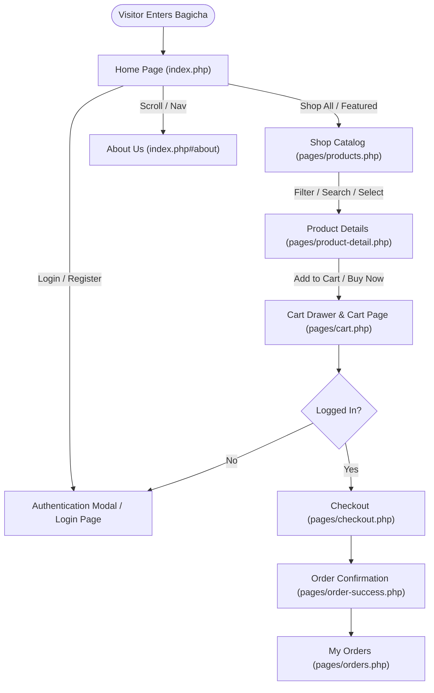
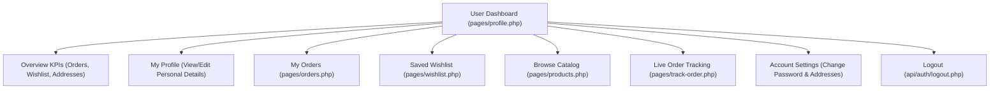
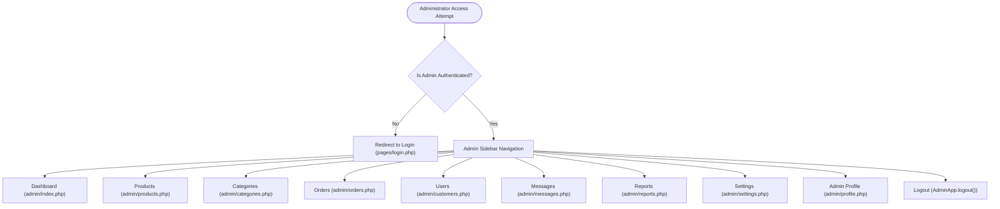

# User and Admin Navigation Flows

Complete navigation and role-based routing architecture for **Bagicha**, the modern biophilic botanical e-commerce platform.

---

## 1. User Navigation Flow

### Public Website
Unauthenticated visitors and prospective plant parents explore public botanical pages with fluid top-level navigation:

- **Home** (`index.php`)
- **Shop** (`pages/products.php`)
- **About Us** (`index.php#about`)
- **Login / Register** (`pages/login.php` or `#authModal`)
- **Product Details** (`pages/product-detail.php?slug={slug}`)
- **Public Order Tracker** (`pages/track-order.php`)
- **7-Day Guarantee** (`pages/guarantee.php`)
- **Contact Us & Support** (`pages/contact.php`)

---

### Main User Flow
The primary commercial conversion funnel:
1. **Home** (`index.php`): Browse seasonal hero promotions, curated categories, and botanical bestsellers.
2. **Shop** (`pages/products.php`): Filter by category, price, maintenance level, pet safety, or search keywords.
3. **Product Details** (`pages/product-detail.php`): Inspect botanical specifications, sunlight requirements, watering guidelines, pincode delivery estimator, bundle savings, and customer reviews.
4. **Cart** (Off-canvas drawer `includes/cart-drawer.php` and full page `pages/cart.php`): Adjust quantities, review subtotal, calculate free shipping threshold.
5. **Checkout** (`pages/checkout.php`): Select or create shipping address, apply discount coupon codes (`GREEN10`, `BAGICHA100`), choose payment method (Razorpay Cards/UPI or Cash on Delivery).
6. **Order Confirmation** (`pages/order-success.php`): Review paid total, order reference number (`BAG-...`), delivery timeline, and order summary.
7. **My Orders** (`pages/orders.php`): Revisit order timeline, milestone tracking, and download invoices.

---

### Authentication Flow
Secure JWT and cookie-based authentication with role detection:

- **Login**:
  - Enter Email & Password.
  - Show/Hide password toggle available.
  - Server verifies via `password_verify` and issues JWT token.
  - Role-based redirect:
    - **Customer** → User Dashboard (`pages/profile.php`)
    - **Admin** → Admin Dashboard (`admin/index.php`)

- **Register**:
  - Enter Full Name, Email, Phone, and Password.
  - System registers user with `role = 'customer'`, auto-logs in, and opens User Dashboard (`pages/profile.php`).

- **Forgot Password**:
  - Open Forgot Password Modal (`#forgotPasswordModal`).
  - Enter email → Request reset token.
  - Verify token + enter new password → Updates password hash securely via `password_hash`.
  - Sign in with new credentials.

---

### User Dashboard Flow
Centralized portal (`pages/profile.php`) for managing botanical orders, plant reminders, and account details:

---

### User Profile Flow
1. **User Dashboard** (`pages/profile.php`).
2. **View Personal Information**: Full name, verified email address, phone number, and account privilege badge.
3. **Edit Profile**: Click Edit button → Opens `#profileEditModal`.
4. **Save Changes**: Validates name and phone → Persists updates via `PUT /api/auth/profile.php`.
5. **Change Password**: Dedicated modal `#changePasswordModal` verifies current password and safely hashes the replacement.

---

### Order Flow
1. **My Orders** (`pages/orders.php`).
2. **Select Order**: Click "Inspect Order" on any order card.
3. **Order Details**: Modal displays line items, quantities, thumbnails, prices, and shipping address.
4. **Order Status**: Current milestone (Pending, Processing, Shipped, Delivered).
5. **Shipping / Delivery Information**: Delivery address, expected carrier timeline, payment method.
6. **Live Public Tracker**: Order Number (`BAG-...`) links to `pages/track-order.php` for milestone tracking.

---

## 2. Admin Navigation Flow

Admin navigation is isolated from the storefront customer experience and protected by `requireAdminPage()` on the server side and `AdminApp.checkAdminAuth()` on the client side.

### Admin Login
- Unauthorized users or guests attempting to access any route under `/admin/*` are immediately redirected to `pages/login.php`.
- Logging in with an admin account securely redirects to `admin/index.php`.

---

### Admin Dashboard (`admin/index.php`)
- **Key Metrics / KPIs**: Total Sales Revenue, Completed Orders, Plant Varieties in Catalog, Registered Customers.
- **Recent Orders Queue**: Real-time status update dropdowns and customer details.
- **Quick Operations**: Add Product, View Stock Alerts, Review Inquiries.

### Product Management Flow (`admin/products.php`)
- **All Products**: Tabular catalog with image thumbnails, categories, pricing, stock levels, and active badges.
- **Search & Filter**: Real-time keyword filter across product names and categories.
- **Add Product**: Modal form with name, category, price, sale price, stock, plant care requirements, and image upload.
- **Edit Product**: Update pricing, botanical details, or restock inventory.
- **Delete / Deactivate Product**: Guarded by `AdminApp.confirmModal(...)` to prevent accidental loss.

### Category Management (`admin/categories.php`)
- **View Categories**: Indoor Plants, Outdoor Plants, Succulents, Planters, Soil & Fertilizers, Tools.
- **Add Category**: Name, slug, description, and cover image.
- **Edit Category**: Update taxonomy or descriptions.
- **Delete Category**: Confirmation guard preventing deletion if associated products exist.

### Order Management (`admin/orders.php`)
- **All Orders**: Filter by status (Pending, Processing, Shipped, Delivered, Cancelled).
- **Inspect Order**: Modal displays line items, pricing breakdown, shipping address, and payment method.
- **Update Order Status**: Inline status selector with instant feedback.
- **Customer Details**: Direct link to customer profile and contact phone/email.

### User Management (`admin/customers.php`)
- **All Users**: Registered customer accounts with join dates, order volume, and lifetime spend.
- **Search / Filter**: Search by customer name, email, or telephone.
- **User Order History**: Inspect all past orders placed by a specific user.

### Messages & Inquiries Management (`admin/messages.php`)
- **Customer Messages Queue**: Incoming inquiries categorized by general, order delivery, or 7-day guarantee claims.
- **Filter & Search**: Filter messages by status (Unread, Replied, Archived).
- **Reply Action**: Inline modal displaying message contents with direct mailto reply and mark-as-replied triggers.

### Reports (`admin/reports.php`)
- **Sales Reports**: Monthly revenue chart and growth trajectories.
- **Order Reports & Fulfillment**: Status breakdown and order volume.
- **Product Reports**: Top-selling botanical varieties and revenue contribution.
- **Export Reports**: Instant one-click CSV export of business and botanical metrics.

### Admin Settings (`admin/settings.php`)
- **Website Settings**: Store name, tagline, announcement banner, contact phone/email.
- **Order & Shipping Settings**: Free shipping order threshold, flat shipping rates.
- **Product Settings**: Links to product catalog and inventory controls.
- **Admin Account Settings**: Link to Admin Profile for credential and password updates.

### Admin Profile (`admin/profile.php`)
- **Personal Details**: View and update administrator name, email, phone number.
- **Admin Password**: Dedicated change password form verifying current password hash.
- **Session Control**: Clearly visible Sign Out button terminating sessions across all devices.

---

## 3. Global Navigation Structure

### User Header (`includes/navbar.php`)
Consistent across every public and customer-facing page:
- **Logo**: Brand mark linking to `index.php`.
- **Home**: Link to `index.php`.
- **Shop**: Link to `pages/products.php` (also highlights active when viewing `product-detail.php`).
- **About Us**: Link to `index.php#about` with smooth scrollspy navigation.
- **Search**: Live debounced search input with thumbnail dropdown and `⌘K` keyboard shortcut.
- **Wishlist**: Heart icon with live badge linking to `pages/wishlist.php`.
- **Cart**: Bag icon with item counter opening the off-canvas cart drawer.
- **Account Controls**:
  - *Guest*: Login and Register action buttons opening `#authModal`.
  - *Authenticated*: Dropdown with **User Dashboard**, **My Orders**, **Wishlist**, **Account Settings**, **Admin Dashboard** (if admin), and **Logout**.

### User Footer (`includes/footer.php`)
Standardized across all public views:
- **Shop & Explore**: Home, Shop All Plants, About Us.
- **Help & Policies**: Contact Us, Refund / Return Policy (`pages/guarantee.php`), Privacy Policy (`#privacyPolicyModal`), Terms & Conditions (`#termsConditionsModal`), Live Order Tracking (`pages/track-order.php`).
- **Green Club Newsletter**: Subscription form with instant feedback.
- **Social Media Links**: Instagram, Facebook, Pinterest, YouTube.
- **Payment Badges**: Razorpay, UPI, Cards, Netbanking.

### Admin Sidebar (`admin/includes/sidebar.php`)
Dedicated administrative navigation:
- **Dashboard**: `admin/index.php`
- **Products**: `admin/products.php`
- **Categories**: `admin/categories.php`
- **Orders**: `admin/orders.php`
- **Users**: `admin/customers.php`
- **Messages**: `admin/messages.php`
- **Reports**: `admin/reports.php`
- **Settings**: `admin/settings.php`
- **Bottom Section**:
  - **Admin Profile**: `admin/profile.php`
  - **Theme Toggle**: Switch Light/Dark Mode
  - **Storefront Link**: Opens public website in new tab
  - **Logout**: Prominent red outline button executing secure session termination

---

## 4. Role-Based Navigation Matrix

| Route / Feature | Guest | Customer (Shopper) | Admin |
| :--- | :---: | :---: | :---: |
| Home (`index.php`) | Full Access | Full Access | Full Access |
| Shop Catalog (`pages/products.php`) | Full Access | Full Access | Full Access |
| Product Details (`pages/product-detail.php`) | Full Access | Full Access | Full Access |
| About Us & Nursery (`index.php#about`) | Full Access | Full Access | Full Access |
| Contact & Support (`pages/contact.php`) | Full Access | Full Access | Full Access |
| 7-Day Guarantee (`pages/guarantee.php`) | Full Access | Full Access | Full Access |
| Cart (`pages/cart.php`) | Full Access | Full Access | Full Access |
| Checkout (`pages/checkout.php`) | Auth Gate (Modal) | Full Access | Full Access |
| Order Confirmation (`pages/order-success.php`) | Auth Required | Full Access | Full Access |
| User Dashboard (`pages/profile.php`) | Redirect to Login | Full Access | Full Access |
| My Orders (`pages/orders.php`) | Redirect to Login | Full Access | Full Access |
| Saved Wishlist (`pages/wishlist.php`) | Redirect to Login | Full Access | Full Access |
| Admin Dashboard (`admin/index.php`) | Forbidden (Redirect to Login) | Forbidden (Redirect to Login) | Full Access |
| Admin Products & Inventory | Forbidden | Forbidden | Full Access |
| Admin Categories Management | Forbidden | Forbidden | Full Access |
| Admin Orders Management | Forbidden | Forbidden | Full Access |
| Admin User Accounts | Forbidden | Forbidden | Full Access |
| Admin Messages & Inquiries | Forbidden | Forbidden | Full Access |
| Admin Reports & Analytics | Forbidden | Forbidden | Full Access |
| Admin Website Settings | Forbidden | Forbidden | Full Access |
| Admin Profile & Security | Forbidden | Forbidden | Full Access |

---

## 5. Navigation UX & Architectural Standards

1. **Consistent Layouts**: Public pages use `includes/header.php`, `includes/navbar.php`, and `includes/footer.php`. Admin pages use `admin/includes/header.php`, `admin/includes/sidebar.php`, and `admin/includes/footer.php`.
2. **Active Page Highlighting**: Active classes are dynamically rendered on both user navbar items and admin sidebar links based on the current URL.
3. **Breadcrumbs on Deeper Views**:
   - `pages/product-detail.php`: Home > Shop > [Product Name]
   - `pages/orders.php`: Home > User Dashboard > Orders
   - `pages/wishlist.php`: Home > User Dashboard > Wishlist
   - `pages/cart.php`: Home > Shopping Cart
   - `pages/checkout.php`: Home > Cart > Checkout
   - `pages/order-success.php`: Home > Shop > Order Confirmation
   - `pages/guarantee.php`: Home > 7-Day Guarantee
   - `pages/contact.php`: Home > Contact Us
   - `admin/*.php`: Dashboard > [Management Section]
4. **Responsive Mobile Navigation**:
   - User Navbar: Accessible hamburger toggle expanding into a clean mobile off-canvas drawer.
   - Admin Sidebar: Sticky top header bar (`.admin-mobile-topbar`) with hamburger trigger, slide-in off-canvas drawer, and backdrop overlay.
5. **State Preservation**: Persistent cart items, wishlist entries, auth credentials, theme selection, and sidebar state across page refreshes.
6. **Destructive Action Safety**: All deletions (addresses, products, categories, users) require confirmation dialogs (`App.confirmModal` / `AdminApp.confirmModal`).
7. **Strict Architectural Limits**:
   - Every PHP file stays strictly under 300 lines.
   - Every JavaScript and CSS file stays strictly under 250 lines.
   - Reusable components are cleanly separated into `includes/` and `admin/includes/`.
